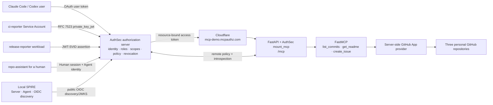

# AuthSec GitHub MCP demo — implementation reference

This is the engineering source of truth for the demo. It documents what exists, why each
boundary exists, how every identity flow reaches the same MCP authorization decision, and
where to inspect the corresponding code. Use `pitch.md` while presenting and `setup.md` for
provisioning/operations.

## 1. Product claim and implementation status

The demo proves that AuthSec can protect one real MCP resource for four caller types:

1. a human using Claude Code or Codex;
2. a Service Account using OAuth client credentials with `private_key_jwt`;
3. a workload using a SPIFFE JWT-SVID;
4. an Agent acting on behalf of a signed-in human through XAA/ID-JAG.

Every caller ultimately presents an AuthSec access token to the same Resource URI:

```text
https://mcp-demo.mcpauthz.com/mcp
```

The identity proof changes. The authorization boundary does not.

Current implementation state:

- protected FastMCP server: complete;
- real personal GitHub App provider hop: complete;
- AuthSec SDK transport-boundary integration: complete;
- M2M, SPIFFE, and XAA identity adapters: complete;
- LangChain ReAct runtime: complete;
- public tunnels and local SPIRE topology: complete;
- preflight, deterministic proofs, smoke, cleanup, and process lifecycle: complete;
- external AuthSec/GitHub records: provisioned on the current machine;
- M2M and SPIFFE end-to-end runs: verified with identity exchange, filtered discovery,
  explicit denial evidence, real GitHub reads, and actual ReAct execution;
- XAA runtime: implemented with expired-session recovery and a write-capable default prompt;
  a fresh presenter browser login is required before each live delegated rehearsal.

## 2. The authorization model

AuthSec owns the runtime decision:

```text
tool requires a scope
role grants scopes
identity receives/binds a role
token represents the currently granted scopes for one resource
MCP boundary verifies identity + token + live policy on every request
```

Canonical relationships:

```text
Reader
  ├─ github_mcp_demo:commits:read
  └─ github_mcp_demo:repo:read

Triage
  ├─ github_mcp_demo:commits:read
  ├─ github_mcp_demo:repo:read
  └─ github_mcp_demo:issues:write

list_commits ──> github_mcp_demo:commits:read
get_readme   ──> github_mcp_demo:repo:read
create_issue ──> github_mcp_demo:issues:write
```

Tool manifest suggestions are advisory metadata. Only AuthSec's administrative mappings
and role assignments are effective authorization policy.

### Access ladder

The SDK implements three distinct outcomes:

1. No bearer: HTTP `401` with a Bearer challenge pointing to RFC 9728 protected-resource
   metadata.
2. Valid identity without the required scope: the tool is removed from `tools/list`. A
   forced raw `tools/call` fails closed as an MCP `isError` result over HTTP 200.
3. Valid identity with the required scope: the tool is visible and callable.

HTTP 200 for the forced denial is MCP transport compatibility. `isError=true` is the hard
authorization result.

## 3. Deployed object inventory

These values are identifiers, not credentials:

| Object | Value |
|---|---|
| AuthSec issuer | `https://app.authsec.ai` |
| Workspace | `41c3ab74-3393-4a2f-abd2-4245fcd8f690` |
| Application | `GitHub MCP Demo` |
| Application ID | `43fc5060-2dca-482a-b69c-1890de19c3ff` |
| Application slug | `github_mcp_demo` |
| Resource URI | `https://mcp-demo.mcpauthz.com/mcp` |
| M2M Service Account | `svc-github-ci` |
| M2M Client ID | `dec85d83-7660-465c-93d4-aa41128f3d91` |
| M2M public key ID | `demo-28d3f699c31e` |
| SPIFFE workload | `wl-release-reporter` |
| SPIFFE ID | `spiffe://authsec.demo/workload/release-reporter` |
| SPIFFE Client ID | `4671a9f4-a415-4f84-8e09-e9cc689ed7f8` |
| Confidential Agent | `agent-repo-assistant` |
| Agent Client ID | `397ad939-8e63-4eca-b8b4-4dcbe128e2b5` |
| GitHub App | `AuthSec Personal MCP Demo` |
| GitHub App ID | `4357796` |
| GitHub installation | `148085763` |

The M2M and Agent Client IDs are deliberately different. Both look like OAuth Client IDs,
but they represent different registrations and authentication methods:

- `svc-github-ci`: Service Account, `private_key_jwt`;
- `agent-repo-assistant`: confidential Agent, client-secret authentication plus user
  delegation.

## 4. Logical architecture



### Trust boundaries

There are four separate credential domains:

1. **Caller → AuthSec:** user login, M2M private key, JWT-SVID, or Agent+user delegation.
2. **Caller → MCP:** only the final AuthSec bearer.
3. **MCP → AuthSec:** server-side introspection credential.
4. **MCP → GitHub:** server-side GitHub App JWT and installation token.

Credentials never cross domains:

- the AuthSec bearer is never sent to GitHub;
- the GitHub installation token is never returned through MCP;
- the introspection secret never enters an agent/workload container;
- the M2M private key belongs to the M2M caller and is never loaded by the MCP server;
- the SPIFFE workload receives neither a GitHub credential nor an AuthSec client secret.

## 5. Repository structure and ownership

```text
authsec-demo/
├── apps/
│   ├── mcp_server/
│   │   ├── app.py                composition root; FastAPI + AuthSec mount
│   │   ├── config.py             strict runtime invariants
│   │   ├── constants.py          canonical names, scopes, repos, URI
│   │   ├── public_keys.py        public M2M JWKS endpoint
│   │   ├── server.py             FastMCP tool schemas only
│   │   ├── tools/                bounded business operations
│   │   └── github/               server-side App authentication/REST clients
│   ├── agents/
│   │   ├── cli.py                login/token/proof/run entrypoint
│   │   ├── config.py             profile scopes, prompts, model
│   │   ├── identity.py           M2M, SPIFFE, XAA token providers
│   │   ├── oauth_trace.py        credential-redacted protocol trace
│   │   ├── proof.py              deterministic allow/deny/read proof
│   │   ├── runtime.py            MCP client + LangChain create_agent
│   │   ├── session.py            human subject session, mode 0600
│   │   └── trace.py              model tool-selection/result rendering
│   └── shared/
│       ├── env.py                strict dotenv helpers
│       └── logging.py            safe correlation and token-claim logs
├── scripts/
│   ├── preflight.py              read-only readiness report
│   ├── validate_share.py         hard server-start validation
│   ├── setup_m2m.py              local RSA/JWKS and M2M state
│   ├── keys.py                   private-key generation
│   ├── bootstrap.py              optional admin API reconciliation
│   ├── authsec_api.py            optional admin API client
│   ├── mcp_rpc.py                raw MCP initialize/list/call helpers
│   ├── smoke.py                  acceptance matrix
│   ├── run_state.py              run-scoped JTI/issue state
│   ├── cleanup.py                guarded reset
│   ├── share.sh                  origin+tunnel+SPIRE supervisor
│   ├── stop-share.sh             deterministic process cleanup
│   └── spire-up.sh               local SPIRE bootstrap
├── spire/
│   ├── docker-compose.spire.yml  Server/Agent/OIDC/workload topology
│   ├── server.conf               trust domain and server data
│   ├── agent.conf                local Agent attestation config
│   ├── oidc.conf                 OIDC discovery provider
│   ├── Dockerfile.workload       isolated release-reporter image
│   └── cloudflared-config.yml.example
├── pitch.md                      live presenter rail
├── setup.md                      provisioning and operation
├── implementation.md             this reference
├── .env.example                  variable contract without credentials
├── pyproject.toml                Python dependencies/entrypoints
├── package.json                  operator aliases
├── .secrets/                     ignored private M2M key
└── .state/                       ignored JWKS/session/run/build state
```

Authorization code is forbidden inside `tools/` and `github/`. It exists once, at the SDK
mount in `app.py`.

## 6. MCP server composition

### Boot sequence

`apps/mcp_server/app.py:create_app()` performs the following in order:

1. configures safe logging;
2. loads/validates server and AuthSec configuration;
3. constructs one `GitHubProvider`;
4. registers three FastMCP tools;
5. creates the FastAPI application;
6. registers GitHub HTTP-client cleanup;
7. adds `/healthz`;
8. adds the public M2M JWKS route;
9. calls `authsec_sdk.runtime.mount_mcp(...)` exactly once at `/mcp`.

The integration line is:

```python
mount_mcp(app, "/mcp", cast(Any, mcp), authsec_config)
```

That SDK mount is responsible for:

- Streamable HTTP MCP transport;
- RFC 9728 protected-resource metadata;
- Bearer challenge/validation;
- remote AuthSec policy loading;
- manifest publication;
- authorization filtering of `tools/list`;
- enforcement of `tools/call`;
- introspection and revocation behavior.

### Runtime invariants

`apps/mcp_server/config.py` refuses to start unless:

```text
issuer           = https://app.authsec.ai
resource_uri     = https://mcp-demo.mcpauthz.com/mcp
resource_name    = GitHub MCP Demo
validation       = jwt_and_introspect
policy           = remote_required
publish_manifest = true
```

`jwt_and_introspect` matters. `jwt_only` would let an already-issued JWT survive until
expiry; `jwt_or_introspect` could short-circuit after local JWT validation. The demo requires
both local validation and live introspection so revocation affects the next request.

`remote_required` prevents a missing/stale local policy from becoming permissive.

### Manifest-first policy

FastMCP supplies the real tool inventory. The server attaches suggestions from
`TOOL_SCOPE_SUGGESTIONS`, but those suggestions do not authorize anything. AuthSec imports
the tools, the administrator maps each actual tool to canonical scopes, and the Application
is activated. Until valid remote policy exists, the boundary remains deny-all/fail-closed.

## 7. Tool contracts

### `list_commits`

Input:

```text
repo  = sdk-authsec | github-mcp-server
limit = 1..20
```

The short name maps server-side to one of:

```text
Aditya250401/sdk-authsec
Aditya250401/github-mcp-server
```

Output includes 12-character SHA, first message line, author, authored time, and GitHub URL.

### `get_readme`

Input uses the same two-repository enum. Base64 GitHub content is decoded and truncated to
20,000 characters before entering model context. Output includes name/path/SHA/URL/content
and a truncation flag.

### `create_issue`

The tool accepts no repository input. It always writes to:

```text
Aditya250401/authsec-demo-sandbox
```

Bounds:

- title: 1–120 trimmed characters;
- body: 1–4,000 trimmed characters;
- run ID: 1–64 alphanumeric/dot/underscore/hyphen characters.

The writer creates/uses label `authsec-demo` and embeds:

```html
<!-- authsec-demo-run:<run_id> -->
```

Cleanup finds only matching sandbox issues, closes them, and adds
`authsec-demo-cleaned`. It never deletes issues or writes to either read repository.

These input/target constraints are defense-in-depth below authorization. They do not
replace AuthSec's identity/scope decision.

## 8. GitHub provider implementation

The provider uses one personal GitHub App installation.

`GitHubAppAuthenticator`:

1. creates an RS256 GitHub App JWT with `iat=now-60`, `exp=now+540`, and `iss=<App ID>`;
2. exchanges it at `/app/installations/<installation>/access_tokens`;
3. caches the installation token conservatively for 50 minutes;
4. renews five minutes before the cached expiry window;
5. serializes concurrent refreshes with an async lock;
6. never logs either credential value.

`GitHubInstallationClient` attaches the installation bearer only to GitHub REST requests,
logs method/path/status, validates expected status codes, and reports the GitHub request ID
on failure.

The App installation selects exactly the two read targets and one sandbox. GitHub App
permissions are installation-wide, so the server-fixed write target is an intentional
second boundary.

## 9. Direct human clients

Claude Code and Codex connect directly to the protected Resource URI. They independently:

1. probe the MCP endpoint;
2. receive a 401 Bearer challenge;
3. discover protected-resource and authorization-server metadata;
4. register/use their own OAuth client;
5. complete user login;
6. receive a resource-bound bearer;
7. call `tools/list` and see only tools allowed by the user's Application role.

AuthSec does not share a bearer between clients. Each client registration, session, token,
and audit trail remains independent.

## 10. M2M private-key-JWT flow

### Key material

`scripts/setup_m2m.py` creates/reuses:

```text
.secrets/svc-github-ci-private.pem
.state/m2m-jwks.json
```

The private directory/key are mode 0700/0600. The public JWKS contains exactly one RSA
public key and no private JWK members such as `d`, `p`, `q`, `dp`, `dq`, or `qi`.

The MCP FastAPI application exposes only that public document at:

```text
/.well-known/m2m-jwks.json
```

with `Cache-Control: public, max-age=300`.

The MCP server never loads the M2M private key. The M2M caller does.

### Token acquisition

`M2MTokenProvider` loads:

- `AUTHSEC_M2M_CLIENT_ID`;
- `AUTHSEC_M2M_PRIVATE_KEY_PATH`;
- `AUTHSEC_M2M_KEY_ID`.

It rejects a Client ID equal to `AUTHSEC_AGENT_CLIENT_ID`, preventing accidental reuse of
the confidential XAA Agent registration.

It constructs:

```python
PrivateKeyJwtAuth(private_key_path, kid=key_id)
AgentIdentity(
    issuer,
    client_id,
    auth=auth,
    preferred_mode="direct-only",
)
```

The AuthSec SDK creates a fresh RFC 7523 client assertion with:

```text
alg = RS256
kid = demo key ID
iss = M2M Client ID
sub = M2M Client ID
aud = https://app.authsec.ai/oauth/token
jti = unique per assertion
iat = current time
exp = iat + 300 seconds
```

Token request:

```text
POST https://app.authsec.ai/oauth/token
grant_type=client_credentials
client_id=<svc-github-ci Client ID>
resource=https://mcp-demo.mcpauthz.com/mcp
scope=github_mcp_demo:commits:read github_mcp_demo:repo:read
client_assertion_type=urn:ietf:params:oauth:client-assertion-type:jwt-bearer
client_assertion=<signed JWT>
```

AuthSec verifies the registered authentication method, public JWKS, signature, `kid`,
audience, lifetime, replay ID, and active Service Account/access grant. It resolves the
Reader scopes and returns a different access token.

Verified access-token evidence:

```text
tf        = m2m
sub       = Service Account subject UUID
client_id = svc-github-ci OAuth Client ID
act       = absent
aud       = https://mcp-demo.mcpauthz.com/mcp
scope     = commits:read + repo:read
jti       = unique
```

The assertion is proof to AuthSec. The access token is permission at the MCP resource.
They are not interchangeable.

### M2M deterministic proof

`uv run demo-agent proof ci-reporter`:

1. logs the exact local PEM path/mode, RSA algorithm, key ID, Client ID, and public JWKS URI;
2. shows the safe header/claims of the signed RFC 7523 assertion and the checks AuthSec
   accepted when it issued the token;
3. renders the actual received token as header/payload plus fingerprint with its bearer
   signature redacted, then displays the decoded access-token claims;
4. calls raw MCP `tools/list` and requires exactly the two read tools;
5. calls `list_commits` and shows the real successful GitHub result first;
6. force-calls `create_issue` with intentionally invalid empty input and requires an AuthSec
   MCP denial second.

The invalid write payload guarantees no GitHub side effect even if policy is accidentally
broadened; correct policy rejects the request earlier.

## 11. SPIFFE/SPIRE workload flow

### Local topology

The Compose project contains:

- `spire-init`: one-shot ownership initialization for named volumes;
- `spire-server`: trust domain `authsec.demo` and JWT signing authority;
- `spire-oidc`: OIDC Discovery Provider bound locally to `127.0.0.1:8443`;
- `spire-agent`: local Workload API at `/run/spire/sockets/agent.sock`;
- `release-reporter`: isolated Agent image, launched only with the `workload` profile.

`scripts/spire-up.sh`:

1. builds wheels for the exact checked-out AuthSec SDK and demo;
2. builds the isolated workload image;
3. starts Server and OIDC Provider;
4. waits for Server readiness;
5. exports the public bootstrap bundle;
6. creates a one-time join token for `spiffe://authsec.demo/agent/demo-host`;
7. starts the Agent with `--no-deps` so Compose does not race/recreate the completed init
   container during rapid restarts;
8. waits for Agent health and, only on an expired cached-SVID trust mismatch, clears the
   demo-owned Agent cache/socket and re-attests once with a fresh join token;
9. idempotently registers the workload entry with selector `unix:uid:0`;
10. waits for OIDC discovery.

The recovery path never clears `server-data`; SPIRE's CA, JWT signing state, and workload
entries remain stable for the public issuer registered with AuthSec.

The workload joins the Agent's PID namespace so SPIRE's Unix workload attestor can resolve
the calling process. It sees the Agent socket read-only.

### Public trust

Only OIDC discovery/JWKS are public through:

```text
https://spire-demo.mcpauthz.com
```

The SPIRE Server API, Agent API, signing state, and Workload API socket remain local.

AuthSec has a Bring-your-own-SPIRE provider:

```text
issuer       = https://spire-demo.mcpauthz.com
trust domain = authsec.demo
subject      = spiffe://authsec.demo/workload/release-reporter
```

The AuthSec-managed Kubernetes path is intentionally not used; it creates
`spiffe://authsec.local/...`, which does not match this local issuer.

### Assertion and token exchange

`SpiffeWorkloadIdentity` asks the local SPIRE Agent for a JWT-SVID with:

```text
sub = spiffe://authsec.demo/workload/release-reporter
aud = https://app.authsec.ai/oauth/token
```

It presents the JWT-SVID at AuthSec `/oauth/token` using the registered SPIFFE Client ID.
AuthSec discovers SPIRE's public keys, validates issuer/signature/audience/exact subject,
resolves the current role, and issues a separate access token for the MCP resource.

`SpiffeHTTPTrace` is injected as the SDK's HTTP session. A complete `pnpm agent:spiffe`
run now shows seven presenter-safe stages:

1. the workload contacts the mounted SPIRE Agent socket with no OAuth client secret;
2. the SDK discovers RFC 9728 protected-resource metadata;
3. the SDK discovers the AuthSec token endpoint;
4. the SDK fetches a real JWT-SVID and sends it as a redacted `client_assertion`;
5. the trace renders only the SVID's public `sub`, `aud`, `iat`, `exp`, lifetime, and exact
   registration match, followed by the separate AuthSec access-token claims;
6. AuthSec filters `tools/list` for that bearer;
7. the ReAct agent selects an allowed MCP tool and consumes the real GitHub result.

The JWT-SVID itself is never printed. Seeing its signed claims in the outgoing token request
proves the SDK actually fetched and exchanged an SVID rather than merely logging an intended
flow.

Two tokens have distinct jobs:

- JWT-SVID: proves which workload is running;
- AuthSec bearer: proves what that workload may do at the MCP server.

The `release-reporter` container environment is allow-listed to issuer/resource,
SPIFFE Client ID/subject/socket, model name, and model credential. It receives no GitHub
App credential, introspection credential, Agent secret, or M2M private key.

## 12. XAA/ID-JAG delegated Agent flow

### Principals and boundary

The signed-in presenter and `agent-repo-assistant` are two principals:

- the presenter is the authenticated human subject;
- `agent-repo-assistant` is the confidential actor;
- GitHub MCP Demo is the target resource Application.

All records are in the same AuthSec workspace. XAA here means cross-application access, not
cross-workspace federation. Workspace equality neither collapses the identities nor grants
access automatically.

### Human login

`uv run demo-agent login` uses authorization code + PKCE through the Agent client with
callback:

```text
http://localhost:8126/callback
```

The presenter may use a dedicated demo user or the presenter/admin account. If the email is
new, the AuthSec login/registration/OTP flow creates the user. The admin Users inventory is
not used to manufacture a human identity.

The resulting OIDC subject token is stored at:

```text
.state/alice-session.json  # legacy filename; contains the current presenter's session
```

with private permissions. Normal logs show safe claims, never the compact token.

### Delegated token acquisition

`XAATokenProvider` constructs an `AgentIdentity` with:

```text
Agent Client ID + Agent client secret
idp_issuer = AuthSec issuer
preferred_mode = xaa-allowed
human subject token = user_session input
target = GitHub MCP Demo Resource URI
requested scopes = Triage scopes
```

The traced protocol sequence is:

1. discover RFC 9728 protected-resource metadata;
2. discover RFC 8414 authorization-server metadata;
3. call requester bootstrap to select the delegated target/relationship;
4. exchange the human's subject token with RFC 8693, requesting an ID-JAG credential;
5. redeem the ID-JAG through RFC 7523 jwt-bearer for the MCP resource;
6. call MCP `tools/list` with the final bearer.

The trace reports grant types, target, requested scopes, status, request ID, and whether a
credential was issued. Subject tokens, client secrets, ID-JAG assertions, and access tokens
remain redacted.

### Optional first-contact pending

If the human begins without a GitHub MCP Demo role, the first redemption returns:

```text
access_pending + request_id
```

No MCP access token exists, so no MCP request or GitHub call occurs. AuthSec persists a
Connection request naming subject, actor, target, and requested scopes.

Approving that request with Triage atomically approves the relationship and supplies the
target role. A fresh token command then succeeds. The normal pitch pre-stages this
write-capable relationship; pending is an optional deeper demonstration.

### Final XAA token

Required evidence:

```text
sub           = signed-in human UUID
act.client_id = agent-repo-assistant Client ID
tf            = xaa
aud           = https://mcp-demo.mcpauthz.com/mcp
scope         = Triage scopes
jti           = unique token ID
```

The Agent is not impersonating the person. The token preserves subject and actor in one
authorization result. Workspace-admin status is not substituted for Application access:
the human/Connection still needs an effective target role that contains the issue action.

ID-JAG is an active Internet-Draft/profile. The implementation must not describe it as a
finalized RFC or claim arbitrary multi-hop delegation.

## 13. LangChain ReAct runtime

All three Agent profiles converge on `apps/agents/runtime.py` after token acquisition.

`build_agent()`:

1. constructs `MultiServerMCPClient` using Streamable HTTP;
2. attaches `Authorization: Bearer <AuthSec token>` only to the MCP connection;
3. calls `get_tools()`—the AuthSec-filtered `tools/list`;
4. attaches `authsec_tool_error_handler` to every returned tool;
5. constructs LangChain v1 `create_agent(model, tools, system_prompt=...)`.

The model never sees hidden tools. This is stronger than asking the prompt not to use them.

Profiles:

| Profile | Token provider | Requested access | Default action |
|---|---|---|---|
| `ci-reporter` | M2M private-key JWT | Reader | summarize `sdk-authsec` commits |
| `release-reporter` | SPIFFE JWT-SVID | Reader | summarize `github-mcp-server` commits |
| `repo-assistant` | human+Agent XAA | Triage/writer | read then create one sandbox issue |

For the two Reader profiles, `run` first uses the same bearer for a real forced write denial
and an allowed provider read. It prints AuthSec's denial reason and confirms the GitHub
writer was not reached, then prints repository/commit evidence for the allowed call. The
same bearer and filtered tool set are then passed into LangChain.

The execution renderer labels the model-selected tool name/arguments, the MCP result as
ALLOWED or DENIED, the returned GitHub object, and the final answer. It does not render
hidden chain-of-thought.

## 14. Live revocation

The Resource Server uses `jwt_and_introspect`. For each MCP request the SDK:

1. verifies the token structure/signature/audience locally;
2. introspects it against AuthSec;
3. combines token validity with live registration/policy state;
4. rejects a revoked token/Connection before invoking the tool.

The live climax intentionally reuses an unexpired XAA token:

```text
approved Connection -> tool succeeds
administrator revokes Connection
same Agent/session sends next tools/call
introspection reports invalid/revoked
MCP returns hard denial
```

This demonstrates that the permission lifetime is not merely the JWT lifetime.

## 15. Logging and secret redaction

Every entrypoint calls `configure_logging()`.

Normal logs include:

- run correlation ID (`DEMO_RUN_ID`);
- HTTP method/path/status;
- grant classification;
- safe JWT header fields (`alg`, `kid`);
- safe claims (`iss`, `sub`, `act`, `tf`, `aud`, `scope`, `jti`, `iat`, `exp`);
- filtered tool names;
- GitHub method/path/status;
- model-selected tool and result.

Normal logs do not include:

- raw bearer/token/assertion strings;
- client secrets;
- private PEM contents;
- GitHub installation tokens;
- the presenter's compact subject token.

Debug controls:

| Variable | Behavior |
|---|---|
| `DEMO_LOG_LEVEL=DEBUG` | demo + AuthSec SDK debug logs |
| `DEMO_LOG_FILE=<path>` | copy safe formatted trace to a local file |
| `DEMO_TRACE_HTTP=full` | `httpcore` wire logs; can reveal Authorization headers |
| `DEMO_LOG_RAW_TOKENS=true` | raw compact tokens at DEBUG |

The last two are local debugging only and must never be enabled during a pitch or in shared
logs.

Backend/Hydra internals do not run in this repo. The demo shows the request/response envelope
and final claims; AuthSec backend logs show native sealing, Hydra exchange, ID-JAG
issuance/redemption, policy resolution, and introspection internals.

Relevant platform code in the shared workspace:

```text
/Users/pc/Desktop/authnull/authsec/controllers/platform/oauth_as_controller.go
/Users/pc/Desktop/authnull/authsec/services/client_auth.go
/Users/pc/Desktop/authnull/authsec/services/xaa_service.go
/Users/pc/Desktop/authnull/authsec/services/scope_resolver.go
/Users/pc/Desktop/authnull/sdk-authsec/packages/python-sdk/src/authsec_sdk/
```

## 16. Process lifecycle

`pnpm share` calls `scripts/share.sh`, which:

1. loads `.env`;
2. acquires an atomic `.state/share.lock` supervisor lock;
3. rejects a live duplicate supervisor and recovers only a dead lock;
4. validates all server-side configuration before opening processes;
5. refuses an existing port-8091 listener;
6. builds/starts SPIRE when enabled;
7. starts both Cloudflare connectors;
8. starts `authsec-demo-server`;
9. waits for local `/healthz`;
10. waits for public MCP `/healthz`;
11. waits for public SPIRE OIDC discovery;
12. polls every managed child because macOS Bash 3.2 lacks `wait -n`;
13. tears the whole group down if one managed child exits.

The EXIT trap stops managed child PIDs, removes the lock, and brings down the SPIRE Compose
project. `pnpm share:stop` handles a lost foreground terminal and also ensures SPIRE is down
when the lock is stale/absent.

The expected stopped state is:

- no listener on TCP 8091;
- no demo MCP/SPIRE Cloudflare process;
- no `authsec-demo-server` process;
- no running services in `spire/docker-compose.spire.yml`.

## 17. Operator commands

| Command | Purpose | Mutation |
|---|---|---|
| `uv run preflight` | environment, binary, issuer, JWKS, MCP, SPIRE checks | read-only |
| `uv run validate-share` | hard server-start configuration gate | read-only |
| `pnpm share` | full foreground process group | local/tunnel connections |
| `pnpm share:stop` | stop full process group | local process state |
| `pnpm m2m:setup` | create/reuse local RSA private/public key | `.secrets`, `.state` |
| `uv run demo-agent login` | presenter OAuth/PKCE login | browser/session state |
| `uv run demo-agent token <profile>` | acquire and display safe token proof | token issuance |
| `uv run demo-agent proof <reader-profile>` | deterministic discovery/denial/read | token + read calls |
| `uv run demo-agent run <profile>` | deny/allow proof plus actual LangChain ReAct run | read/write by profile |
| `pnpm agent:spiffe:proof` | readiness-gated isolated workload deterministic proof | token + read calls |
| `pnpm agent:spiffe` | readiness-gated isolated workload ReAct run; bounded pre-token JWKS retry | token + read calls |
| `uv run smoke ...` | multi-act acceptance matrix | depends on flags |
| `uv run bootstrap` | optional admin reconciliation | requires admin token |
| `uv run reset <run_id>` | scoped revocation/issue cleanup | requires admin token |

## 18. Preflight and failure semantics

Preflight distinguishes readiness from identity correctness:

- MCP `401`: PASS, protected endpoint is reachable;
- Cloudflare `530`: WARN/FAIL depending check, connector/origin stopped;
- issuer/JWKS 200: authorization server reachable;
- SPIRE discovery 200: workload issuer reachable;
- missing identity fields: names only, never values;
- full share validation: refuses startup on missing secrets, wrong URI/name/modes, unreadable
  PEM, or invalid tunnel configuration.

Selected error meanings:

| Error | Layer | Meaning |
|---|---|---|
| Cloudflare `530` | public routing | DNS exists but local connector/origin is absent |
| `Unknown MCP server` after `530` | SDK discovery | protected-resource metadata could not be fetched |
| `client does not support private_key_jwt` | AuthSec client auth | wrong client registration/auth method |
| `invalid_scope` | AuthSec scope resolution | requested scopes are not granted/recognized |
| tool absent | MCP policy filtering | identity lacks its mapped scope |
| HTTP 200 + `isError=true` | MCP enforcement | forced tool call denied in-band |
| `access_pending` | XAA target approval | subject–actor relationship/role not yet approved |
| revoked/invalid after live call | introspection | grant/token/Connection no longer active |
| GitHub 403/404 | upstream provider | App permission/installation/repo mismatch |

## 19. Acceptance evidence

The implementation is acceptable only when these assertions hold:

| ID | Assertion | Required evidence |
|---|---|---|
| 0a | unauthenticated MCP denied | 401 + Bearer challenge |
| 0b | protected-resource metadata valid | 200, correct resource and AuthSec issuer |
| 0c | Reader least visibility | exactly `list_commits`, `get_readme` |
| 0d | forced write fail-closed | HTTP 200, MCP `isError=true` |
| 1a | M2M token correct | `tf=m2m`, service `sub`, resource `aud`, Reader scopes, JTI |
| 1b | M2M real provider read | GitHub commits returned |
| 2 | SPIFFE workload correct | redacted SVID claims/exchange, no client secret, deny+read+ReAct succeeds |
| 3a | first XAA contact gated | `access_pending`, request ID, no MCP call |
| 3b | approved delegation attributed | human `sub`, Agent `act`, `tf=xaa`, writer relationship |
| 3c | authorized write constrained | one labeled/run-marked sandbox issue |
| 4 | revocation live | same unexpired token denied on next call |

## 20. Cleanup safety

`scripts/cleanup.py` requires an explicit admin token and verifies:

- token workspace when the claim exists;
- configured workspace ID;
- Application ID, name, workspace, and Resource URI;
- hard-pinned sandbox repository;
- syntactically safe run ID.

It then:

1. revokes only recorded JTIs;
2. deletes/revokes only the Agent Connection for this Application;
3. closes only sandbox issues with the exact run marker;
4. attempts to recreate the expected pending request for the next rehearsal;
5. leaves durable platform setup intact.

No code path deletes arbitrary GitHub issues, changes read repositories, wipes a workspace,
or bypasses the resource guards.

## 21. Standards and precise claims

| Standard/profile | Use in the demo |
|---|---|
| OAuth/OIDC | user authentication and client authorization |
| RFC 6750 | Bearer usage/challenge semantics |
| RFC 7523 | M2M private-key JWT and ID-JAG jwt-bearer redemption |
| RFC 8414 | authorization-server metadata |
| RFC 8693 | human subject-token exchange |
| RFC 8707 | Resource URI/audience targeting |
| RFC 9728 | protected-resource metadata |
| MCP Streamable HTTP | client/server tool discovery and calls |
| SPIFFE | workload identity model and SVID formats |
| SPIRE | local workload attestation and JWT-SVID issuance |
| ID-JAG/XAA profile | subject+actor delegated Agent flow; active draft/profile |

Claims that must remain honest:

- M2M has no shared OAuth client secret, but the caller still possesses a long-lived local
  private key; SPIFFE is the no-long-lived-workload-secret act.
- The MCP server has server-side introspection and GitHub credentials. “Secretless” refers
  to the workload, not the entire system.
- AuthSec governs identity/scope/role/registration/revocation. Tool arguments and fixed
  provider targets are the server's responsibility.
- Same-workspace XAA is real cross-application delegation. The demo does not demonstrate
  cross-workspace federation.
- The execution trace shows protocol and tool actions, not hidden model reasoning.
- Native AuthSec tokens and Hydra-backed flows coexist behind the AuthSec issuer/JWKS
  contract; do not imply every grant takes the same internal minting route.

## 22. Non-goals

This demo intentionally does not include:

- the AuthSec connector product;
- arbitrary access to the full official GitHub MCP surface;
- arbitrary repository names or generic write tools;
- organization-owner-only GitHub resources;
- cross-workspace federation;
- arbitrary multi-hop/subagent delegation;
- secrets embedded in source or documentation;
- UI automation for consent, approval, GitHub App creation, or one-time secret capture;
- a production SPIRE/Kubernetes deployment.

The narrow surface is deliberate: it makes identity, policy, attribution, and revocation
observable without provider-side risk obscuring the AuthSec product proof.
